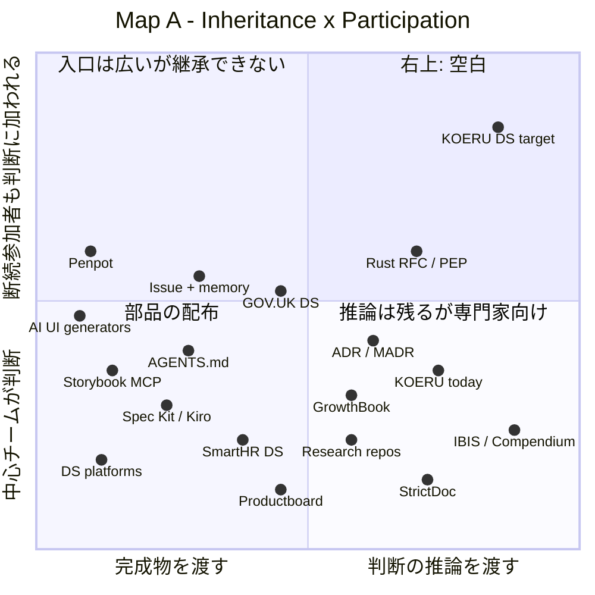
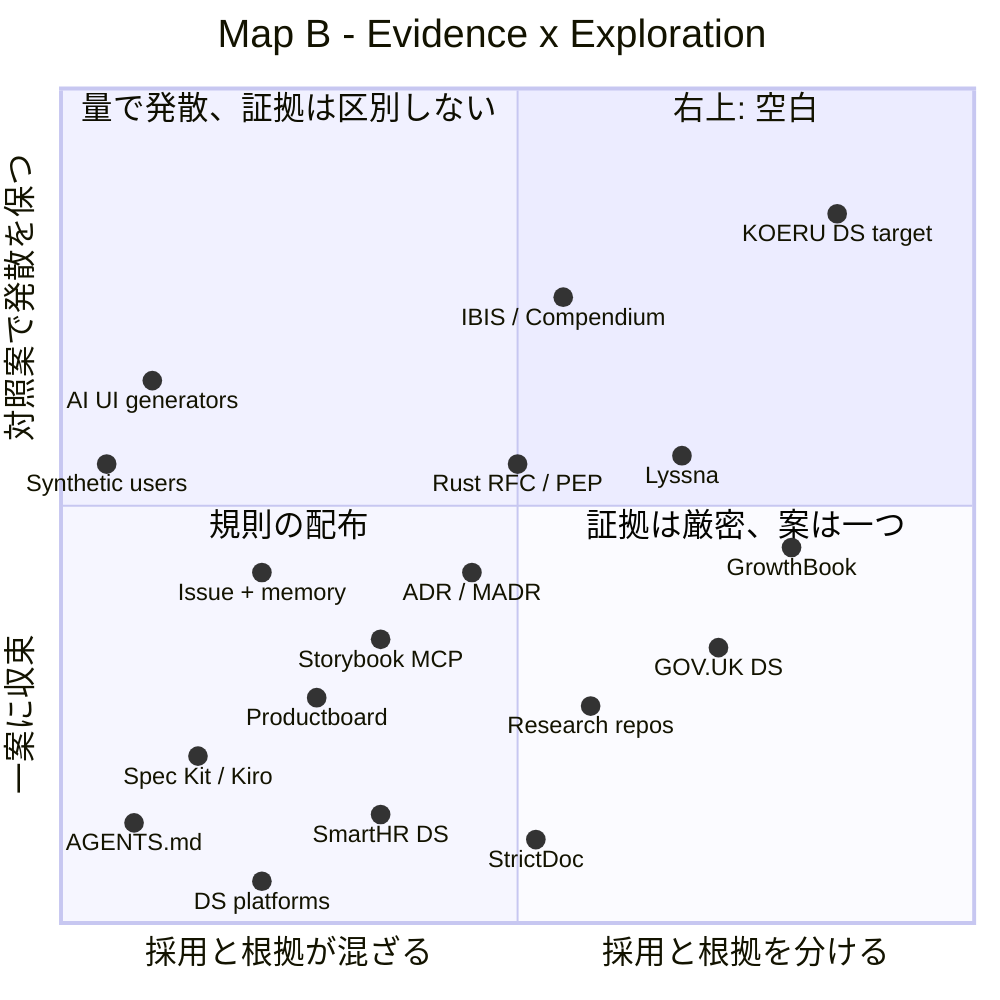

# KOERU Design System の市場地図

[KOERU Design System](../design-system/koeru_design_system_proposal_full.md) と同じ痛みに使える既存の手段を、2枚の4象限マップに置いた調査報告。結論として、どちらの地図でも右上は薄い。ただし空いている主な理由は、そこを埋めるのにかかる運用の費用にあると推測する。読者は、この費用が KOERU で本当に便益を下回るかを、提案書 §15.3 の反証条件で確かめる順序を決める。

この文書は読み物で、正本ではない。他の製品がそうしていることは、KOERU の UX が妥当である証拠にならない（提案書 §8.1.1）。料金・規模は大半が未確認で、地図上の位置は公開資料からの推測である。

```text
[痛み: 判断の理由と前提が見えず、途中から疑い直せない]
        │
        ├──▶ [地図 A: 受け継ぐもの × 判断に加われる人] ──▶ 右上は薄い
        │
        └──▶ [地図 B: 根拠の扱い × 探索の幅] ──────────▶ 右上は薄い
                                                          │
                                                          ▼
                              [空いている理由の推測: 運用の費用が高い]
                                                          │
                                                          ▼
                              [次の行動: 1画面で一周し、費用と便益を測る]
```

## 調査の枠組み

| 項目 | 内容                                                                                                                                                    |
| ---- | ------------------------------------------------------------------------------------------------------------------------------------------------------- |
| 痛み | 小規模な創作ツールの開発で、過去の設計判断の理由・前提・撤回条件が見えなくなる。断続的な参加者、復帰者、AI エージェントが判断を疑い直せず、引き継げない |
| 対象 | 単一製品の OSS や小規模チームで創作ツールを作る contributor と maintainer。Context を読む AI コーディングエージェントを含む                             |
| 範囲 | デザインシステム、判断記録、UX の根拠管理、AI による設計支援、OSS のガバナンス。商用 SaaS、OSS、非公式な運用を含む                                      |
| 前提 | KOERU Design System は販売する製品ではなく、KOERU の開発基盤である。ここでの「市場」は、同じ痛みに対して開発者が選びうる手段を指す                      |

## 地図 A: 受け継ぐもの × 判断に加われる人

| 軸                  | 左／下                                                  | 右／上（望ましい側）                                                             |
| ------------------- | ------------------------------------------------------- | -------------------------------------------------------------------------------- |
| X: 受け継ぐもの     | 完成物（部品、token、規則、spec）。「何に従うか」を渡す | 判断の推論（問い、仮説、証拠、撤回条件）が型付きでつながり、覆せる               |
| Y: 判断に加われる人 | 中心チーム、継続参加者、審査を通った人                  | 断続的な参加者、新参者、復帰者が、元作者なしで途中から判断に加わり、異議を出せる |



| Service / Cluster                                      |   X    |   Y    | 根拠                                                                                   |
| ------------------------------------------------------ | :----: | :----: | -------------------------------------------------------------------------------------- |
| DS プラットフォーム（zeroheight、Supernova、Knapsack） |   低   |   低   | 部品と token を配る。判断するのは DS チーム                                            |
| Storybook と MCP                                       |   低   | 低〜中 | 部品のメタデータとテストをエージェントに渡す。理由は渡らない                           |
| GitHub Spec Kit、Kiro                                  |   低   | 低〜中 | spec を正本とし、エージェントが従う。spec を疑い直す経路はない                         |
| AGENTS.md などのルールファイル                         |   低   |   中   | 誰でも書けるが、中身は規則で、理由と反証は載らない                                     |
| SmartHR Design System                                  | 低〜中 | 低〜中 | 原則と運用ガイドを公開する。判断は社内のチームが持つ ※推測                             |
| GOV.UK Design System                                   |   中   |   中   | 誰でも提案できるが、working group が useful・unique・usable の基準で審査する           |
| Penpot                                                 |   低   |   中   | OSS で参加の入口は広い。設計判断の継承は扱わない ※推測                                 |
| AI UI 生成（Figma Make、Google Stitch）                |   低   |   中   | 誰でも案を出せるが、判断には加われない                                                 |
| GitHub Issue と元作者の記憶                            | 低〜中 |   中   | 入口は広い。理由が人に残るため、離脱すると消える                                       |
| UX リサーチリポジトリ（Dovetail、Condens、Marvin）     |   中   |   低   | 観察と洞察を蓄積するが、研究者が運用する                                               |
| Productboard                                           |   中   |   低   | フィードバックを機能に紐づけるが、PM が判断する                                        |
| GrowthBook                                             |   中   |   低   | 仮説と結果を分けて持つが、実験を設計できる人に限られる                                 |
| ADR（Log4brains、MADR）                                | 中〜高 | 低〜中 | 判断の理由を Git に残す。判断はフラットに並び、仮説や後継と型付きでつながらない        |
| StrictDoc、sphinx-needs                                |   高   |   低   | 要求・実装・テストを型付きで追跡する。規制対応の専門チームが前提                       |
| IBIS、Compendium                                       |   高   | 低〜中 | 問い・立場・論拠を地図にする。ファシリテータ付きの同期会議が前提                       |
| Rust RFC、Python PEP                                   |   高   |   中   | 誰でも提案・異議を出せ、却下案も残る。文脈に詳しい人ほど有利で、注目を集めないと止まる |
| KOERU の現状（`meta/`、FSL、`cargo xtask touched`）    |   高   | 低〜中 | 判断・撤回条件・証拠を分けて持つ。読み解くには文脈の習熟が要る                         |
| ★ KOERU Design System（目標の仮置き）                  |   高   |   高   | 推論を型付きで持ったまま、`context --from` で途中参加・復帰を支える                    |

### 地図 A の象限

| 象限 | 何があるか                               | 混み具合 | 示唆                                                                                           |
| ---- | ---------------------------------------- | -------- | ---------------------------------------------------------------------------------------------- |
| 右上 | Rust RFC / PEP が下端にかかる            | 薄い     | 本命の議論場。上半分は空いている                                                               |
| 右下 | ADR、StrictDoc、IBIS、KOERU の現状       | 中       | 推論は残るが、読み書きに専門性と習熟が要る                                                     |
| 左上 | Penpot、AI UI 生成、Issue と記憶         | 中       | 誰でも入れるが、判断の理由を受け継げない                                                       |
| 左下 | DS プラットフォーム、Spec Kit、Storybook | 混雑     | 商用の主戦場。AI エージェントへ Context を渡す方向に寄っている（zeroheight AI、Storybook MCP） |

## 地図 B: 根拠の扱い × 探索の幅

| 軸            | 左／下                                                                                            | 右／上（望ましい側）                                                           |
| ------------- | ------------------------------------------------------------------------------------------------- | ------------------------------------------------------------------------------ |
| X: 根拠の扱い | 採用と根拠が混ざる。証拠の量で優先度が決まり、合成ユーザーの発言や green の CI を検証済みとみなす | 採用状態と根拠状態を分ける。証拠の出所と、その証拠が何を証言できるかを区別する |
| Y: 探索の幅   | 一案に収束する（一貫性と再利用を最大化する）                                                      | 前提の異なる対照案と反例を並べ、発散を保つ                                     |



| Service / Cluster                                    |   X    |   Y    | 根拠                                                                                      |
| ---------------------------------------------------- | :----: | :----: | ----------------------------------------------------------------------------------------- |
| DS プラットフォーム、Spec Kit、AGENTS.md、SmartHR DS |   低   |   低   | 根拠を持つ場所がなく、一つの規範に収束させる                                              |
| Storybook と MCP                                     | 低〜中 | 低〜中 | テストの結果はあるが、green と体験の妥当性を分けない。story で案を並べられる              |
| GOV.UK Design System                                 |   高   | 低〜中 | 公開前に代表的な利用者での調査を要求する。採用するのは一つのパターン                      |
| AI UI 生成                                           |   低   | 中〜高 | 案を大量に出すが、前提の差は小さい。初期例への fixation の懸念がある（提案書 §2.2）       |
| 合成ユーザー                                         |   低   |   中   | 発言を速く得られるが、平均化と迎合により証拠として扱えない                                |
| GitHub Issue と元作者の記憶                          | 低〜中 | 低〜中 | 案も根拠も議論に埋もれる                                                                  |
| UX リサーチリポジトリ                                | 中〜高 | 低〜中 | 生データと分析を分けて持つ。案の比較は扱わない                                            |
| Lyssna                                               | 中〜高 |   中   | 作者の説明なしで「何が読めたか」を測る（Blind Read に近い）。preference test で案を比べる |
| Productboard                                         | 低〜中 |   低   | 蓄積した証拠の量が優先度を決める                                                          |
| GrowthBook                                           |   高   |   中   | 仮説と結果を分ける。比較するのは定量の A/B で、トラフィックが要る                         |
| ADR                                                  |   中   |   中   | 検討した案は残るが、証拠の状態は持たない                                                  |
| StrictDoc                                            |   中   |   低   | 検証の追跡はあるが、案の探索は扱わない                                                    |
| IBIS、Compendium                                     |   中   |   高   | 問いに対する複数の立場を明示する。証拠の出所までは型にしない                              |
| Rust RFC、Python PEP                                 |   中   |   中   | 代替案の節を持つ。証拠の扱いは提案者に任される                                            |
| ★ KOERU Design System（目標の仮置き）                |   高   |   高   | `HYP` と `EVID` を分け、前提の異なる案を並べる。合成ユーザーの発言を証拠にしない          |

### 地図 B の象限

| 象限 | 何があるか                                                 | 混み具合       | 示唆                                         |
| ---- | ---------------------------------------------------------- | -------------- | -------------------------------------------- |
| 右上 | IBIS と Lyssna が縁にあり、GrowthBook が境界のすぐ下にある | 薄い           | 本命の議論場。質的な創作体験を扱うものはない |
| 右下 | GOV.UK DS、リサーチリポジトリ、GrowthBook                  | 中             | 証拠は厳密だが、案を一つに絞ってから測る     |
| 左上 | AI UI 生成、合成ユーザー                                   | 中、伸びている | 発散は量で作り、証拠は区別しない             |
| 左下 | DS プラットフォーム、Spec Kit、Productboard                | 混雑           | 規則を配り、証拠の量で優先する               |

## 空白の右上

### 空いているか: 薄い

地図 A の右上には Rust RFC / PEP が下端にかかるだけで、上半分は空いている。地図 B の右上には IBIS と Lyssna が縁にあり、GrowthBook が境界のすぐ下にある。ただし、質的な創作体験について案を並べ、答えられる範囲だけを証拠にするものはない。

### 空いている理由（推測）

主な理由は、推論を構造化して持つ運用の費用だと推測する。根拠は、右側にあるツールがどれも費用を払う専任の役割を前提にしていることである。

- StrictDoc は規制対応のチーム、IBIS はファシリテータ、リサーチリポジトリは研究者、GrowthBook は統計的に有意な量のトラフィックを前提にする。断続的な参加者は、この費用を払えない。
- 商用の DS プラットフォームは、多チームの企業で中心チームが規範を配ることに価値を置く。単一製品の OSS は買い手にならないため、右上を狙う商業的な動機がない。
- 誰でも入れる Rust RFC は、言語のような大規模コミュニティの注目の量に支えられている。小規模な OSS で同じ形を採ると、沈黙で止まる（提案書 §2.1）。

### 取りにいくのに要るもの

右上に立つには、推論を構造化したまま、参加と記録の費用を断続的な参加者が払える水準まで下げる必要がある。提案書の設計では、Signal を自由記述で受け、必要なものだけを `Q/HYP/EVID/DEC/REQ` に昇格する（§6、§5.1.2）。また `context` コマンドで、元作者なしに判断を組み立て直せるようにする（§7）。この2つが費用を下げる中心になる。

### 偽の空白のリスク

| リスク                           | 内容                                                                                                                               | 確度                                                  |
| -------------------------------- | ---------------------------------------------------------------------------------------------------------------------------------- | ----------------------------------------------------- |
| 非公式な運用で足りる             | 小規模なチームが Issue テンプレート、ADR、デザイン批評会を組み合わせ、見えない形で右上を埋めている                                 | 未確認                                                |
| AI 向け Context ツールが右へ動く | zeroheight、Supernova、Storybook MCP は AI エージェント向けの Context に寄っている。判断の理由まで扱い始めると、左下から右へ伸びる | 推測（根拠: 各社が AI 向け Context を打ち出している） |
| spec 駆動ツールが理由を持つ      | Spec Kit や Kiro が、spec の前提や撤回条件を持つ方向に拡張する                                                                     | 推測                                                  |
| 右上は需要がないから空いている   | 運用の費用が便益を上回るため、誰も取りにいかない                                                                                   | 未確認。KOERU で測る（次の行動を参照）                |

最後のリスクが最も重い。提案書 §15.3 は「R1 を4件程度通して、準備作業のほうが試作より重く、判断が変わった事例もない」を反証条件に挙げている。地図はこの条件が成り立つ可能性を否定しない。

## 隣の象限から借りられるもの

右上を一から作らず、近い位置にある手段の型を借りられる。どれを採るかは未定で、採る場合は `DEC-*` で決める。

| 借りる先                | 借りるもの                                                                   | 提案書の対応箇所             |
| ----------------------- | ---------------------------------------------------------------------------- | ---------------------------- |
| Storybook MCP           | エージェントへ部品の Context とテストを渡す口。KOERU は Storybook を採用済み | §12.2、C9                    |
| ADR（MADR）             | 判断1件を1ファイルに書く軽い書式                                             | `DEC-*` の schema            |
| StrictDoc、sphinx-needs | 型付きの関係と追跡の検査                                                     | §7.1 の edge、`check-design` |
| GOV.UK DS               | 適用範囲と検証済み範囲を分けて書く contribution 基準                         | §2.1                         |
| Lyssna の5秒テスト      | 作者の説明なしで読めたものを測る手順                                         | §9.1.1 Blind Read            |
| GrowthBook              | 仮説と結果を分けて記録する形                                                 | §3.2、`HYP-*`                |

## 次の行動

1. 提案書の結論どおり、1画面（Voice 画面など）で「Signal → Context → 対照案 → Evidence → 採用」を一周させる。その際、準備作業の時間と、判断が変わったかを記録する。担当と期限は未定。
2. 一周の結果を §15.3 の反証条件と照らし、右上が「費用のために空いている」のか「需要がないから空いている」のかを判断する。
3. 外部の contributor に聞き取りをする場合は、次の問いを使う。
   - 過去の設計判断を変えたいと思ったとき、最初に何を読み、どこで諦めたか。
   - 半年離れた後に戻ったとき、何が変わったかをどうやって知ったか。
   - 既存の方針に反対したとき、反対を書くまでにかかった手間は何か。

## 付録: 調査したサービス

料金と規模は確認していない。出典は各行のリンク先。

| Service                                                                                                                                                                                 | 種類   | 何をするか                                                          | 選ばれる理由                                 | 詰まる点                                                |
| --------------------------------------------------------------------------------------------------------------------------------------------------------------------------------------- | ------ | ------------------------------------------------------------------- | -------------------------------------------- | ------------------------------------------------------- |
| [zeroheight](https://www.zeroheight.com/ai)                                                                                                                                             | 直接   | DS ドキュメントの作成・公開・ガバナンス。AI ツールへ Context を渡す | 非エンジニアでも書ける                       | 判断の理由や反証を書く場所がない                        |
| [Supernova](https://www.supernova.io/vs/zeroheight)                                                                                                                                     | 直接   | token、部品、docs を AI エージェント向けの構造化 Context にまとめる | design-to-code を自動化できる                | 「なぜか」は渡らない                                    |
| [Knapsack](https://www.knapsack.cloud/zeroheight-vs-knapsack)                                                                                                                           | 直接   | コードの実部品を載せる DS プラットフォーム                          | 実装とドキュメントが乖離しない               | 企業の多チーム向け                                      |
| [Storybook MCP、Chromatic](https://www.chromatic.com/docs/mcp)                                                                                                                          | 直接   | 部品のメタデータ、docs、テストをエージェントへ渡す                  | 実物で比較でき、エージェントが自己修正できる | 部品単位で、体験の前提は扱わない                        |
| [GOV.UK Design System](https://design-system.service.gov.uk/community/contribution-criteria/)                                                                                           | 直接   | 公開 DS。useful、unique、usable の基準で contribution を審査する    | 利用者調査の証拠を要求する                   | 探索中の案は入りにくい                                  |
| [SmartHR Design System](https://codezine.jp/article/detail/13865)                                                                                                                       | 直接   | 原則と運用ガイドから段階的に公開した国内の DS                       | 製品に関わる全員を読者にした                 | 判断の履歴より現在の規範が中心                          |
| [Penpot](https://community.penpot.app/t/your-guide-to-contributing-to-penpot/10060)                                                                                                     | 隣接   | OSS のデザインツールとコミュニティ                                  | デザイナーが OSS に参加する入口              | 設計判断の継承は扱わない                                |
| [Figma Make、Google Stitch](https://www.mindstudio.ai/blog/google-stitch-vs-figma-ai-design-comparison)                                                                                 | 隣接   | プロンプトから UI 案を生成する                                      | 案を速く大量に出せる                         | 初期例への fixation。生成物の作者性と証拠能力が混ざる   |
| [Dovetail、Condens、Marvin](https://www.koji.so/blog/dovetail-vs-condens-2026)                                                                                                          | 隣接   | UX リサーチの観察と洞察を蓄積する                                   | 生データと分析を並べて再利用できる           | 研究組織が前提で、判断や撤回条件とつながらない          |
| [Lyssna](https://lyssna.com/guides/five-second-testing)                                                                                                                                 | 参考   | 5秒テスト、ファーストクリックなどの非モデレート型テスト             | 作者の説明なしで読めたものを測れる           | パネルの回答者は KOERU の利用者ではない                 |
| [合成ユーザー](https://www.viget.com/articles/synthetic-users/)                                                                                                                         | 隣接   | AI ペルソナにインタビューする                                       | 速く安い                                     | 平均化と迎合。証拠とみなすと Evidence Laundering になる |
| [Productboard](https://support.productboard.com/hc/en-us/articles/360056354514)                                                                                                         | 隣接   | フィードバックを機能アイデアに紐づけ、優先度を決める                | 声の大きさではなく蓄積で決められる           | 証拠の量が採用に直結する                                |
| [GrowthBook](https://docs.growthbook.io/using)                                                                                                                                          | 隣接   | OSS の実験基盤。仮説を記録し、結果を統計で示す                      | 仮説と結果を分ける                           | 定量の A/B が前提                                       |
| [Log4brains、MADR](https://github.com/thomvaill/log4brains/)                                                                                                                            | 隣接   | ADR を Git で書き、静的サイトとして公開する                         | docs-as-code で軽い                          | 仮説・証拠・後継と型付きでつながらない                  |
| [StrictDoc](https://strictdoc.readthedocs.io/en/stable/stable/docs/strictdoc_02_feature_map-DEEP-TRACE.html)、[sphinx-needs](https://github.com/useblocks/sphinx-needs/discussions/206) | 参考   | 要求、実装、テストを ID と関係で追跡する                            | 型付きの追跡グラフ                           | 規範の管理に限られ、問いや異議を持たない                |
| [GitHub Spec Kit、Kiro](https://www.martinfowler.com/articles/exploring-gen-ai/sdd-3-tools.html)                                                                                        | 隣接   | spec を正本とし、AI エージェントに実装させる                        | エージェントの精度が上がる                   | spec が当然の制約になり、前提を疑い直す経路がない       |
| [Compendium（IBIS）](https://research-archive.stem.open.ac.uk/stemra-data/uploads/sites/71/2024/11/Compendium_DCC2006_Final.pdf)                                                        | 参考   | 問い、立場、論拠を地図にする                                        | wicked problem の設計空間を扱える            | ファシリテータと同期の会議が前提                        |
| [Rust RFC](https://rust-lang.github.io/rfcs/0002-rfc-process.html)、[Python PEP](https://peps.python.org/pep-8002/)                                                                     | 参考   | OSS の公開熟議で設計判断を決める                                    | 誰でも提案と異議を出せ、判断が残る           | 参加の費用が高く、注目を集めないと止まる                |
| GitHub Issue、Notion などの判断ログ、元作者の記憶                                                                                                                                       | 非公式 | 議論を散らばらせ、理由を人に残す                                    | 追加の手間がない                             | 離脱すると理由が消える                                  |
| AGENTS.md、CLAUDE.md などのルールファイル                                                                                                                                               | 非公式 | エージェント向けの Context を手で書く                               | すぐ書ける                                   | 規則が二重化して古くなり、理由と反証は載らない          |
