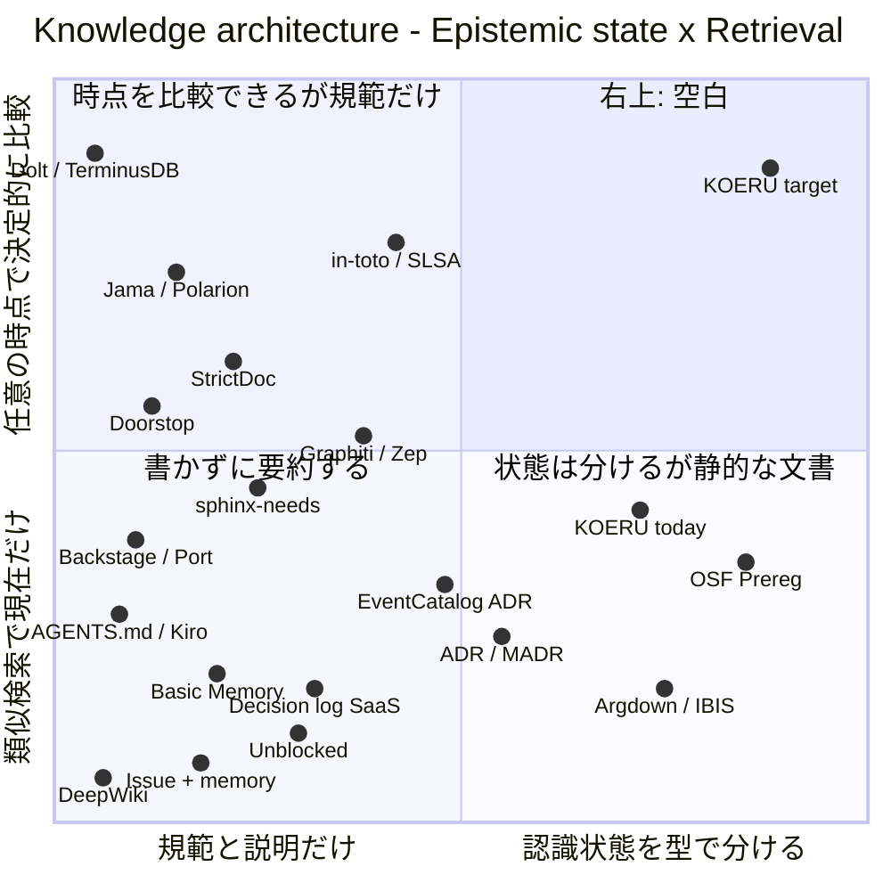

# KOERU の知識管理アーキテクチャの市場地図

[KOERU Design System](../design-system/koeru_design_system_proposal_full.md) が下に敷く知識管理アーキテクチャ（`Q/HYP/EVID/DEC/REQ` の graph、`context` コマンド、Probe と Receipt）について、同じ痛みに使える既存の手段を4象限マップに置いた調査報告。結論として、右上は空いている。時点の比較を持つ手段は規範か汎用データしか扱わず、認識状態を分ける手段は静的な文書にとどまる。読者は、まず右上の価値が `git diff` と既存の手段の組み合わせで足りないかを確かめ、借りる型を `DEC-*` で決める。

この文書は読み物で、正本ではない。料金・規模は大半が未確認で、地図上の位置は公開資料からの推測である。Design System 全体の地図は [design-system.md](design-system.md) にあり、この文書はその下の知識基盤の層だけを扱う。

```text
[痛み: いま何が有効で、なぜで、何が変わったかを組み立て直せない]
        │
        ▼
[地図: 知識の認識状態 × 取り出しの決定性と時点] ──▶ 右上は空いている
        │
        ├──▶ 左上: 時点の比較はあるが、規範か汎用データだけ
        ├──▶ 右下: 認識状態はあるが、静的な文書
        │
        ▼
[空いている理由の推測: 型を書く費用を払う利用者がいない]
        │
        ▼
[次の行動: git diff で足りるかを過去の2点で数える]
```

## 調査の枠組み

| 項目 | 内容                                                                                                                                                                                                                                               |
| ---- | -------------------------------------------------------------------------------------------------------------------------------------------------------------------------------------------------------------------------------------------------- |
| 痛み | 小規模で参加が断続的な OSS で、人もエージェントも「いま何が有効か、なぜか、どの前提が未検証か、離れてから何が変わったか」を、全文を読むか元作者に聞かないと組み立て直せない。検証の痕跡（green の CI、リンクの存在）が、そのまま根拠として読まれる |
| 対象 | KOERU の maintainer と contributor（復帰者を含む）、Context を読む AI コーディングエージェント                                                                                                                                                     |
| 範囲 | プロジェクトの知識を蓄積し取り出す手段。要求の追跡、ADR、エージェント向けの Context とメモリ、版管理つきの DB、実行の証明、論証の構造化、研究の事前登録、非公式な運用                                                                              |
| 前提 | 販売する製品ではないので、ここでの「市場」は開発者が選びうる手段を指す。ローカル完結と Git 管理は KOERU の制約で、軸ではなく条件として扱う                                                                                                         |

## 地図: 知識の認識状態 × 取り出しの決定性と時点

| 軸                        | 左／下                                                         | 右／上（望ましい側）                                                             |
| ------------------------- | -------------------------------------------------------------- | -------------------------------------------------------------------------------- |
| X: 知識の認識状態         | 現在の規範と説明だけを持つ。仮説・観測・判断が同じ文章に混ざる | 仮説・観測・判断・義務を型で分け、反証と後継を edge として持つ。機械で検査できる |
| Y: 取り出しの決定性と時点 | 類似検索や LLM の要約で、現在だけを返す                        | 任意の revision で決定的に閉包を組み立て、時点間の意味の差分を返す               |



| Service / Cluster                                   |   X    |   Y    | 根拠                                                                                               |
| --------------------------------------------------- | :----: | :----: | -------------------------------------------------------------------------------------------------- |
| Dolt、TerminusDB                                    |   低   |   高   | `AS OF` で任意の commit を問い合わせ、2点間を diff する。中身は意味を持たない汎用データ            |
| Jama Connect、Polarion                              |   低   |   高   | 上流が変わると下流を suspect にし、版を並べて比べる。扱うのは要求とテストのつながり                |
| in-toto、SLSA VSA                                   |   中   |   高   | 実行の主張（attestation）と、それへの policy の判定を分ける。仮説や観測の区別は扱わない            |
| StrictDoc                                           | 低〜中 | 中〜高 | 要求を型付きの文法で書き、2つの Git revision の間で差分と changelog を出す                         |
| Doorstop                                            |   低   |   中   | 親の fingerprint が変わると、子へのリンクを suspect として報告する                                 |
| Graphiti、Zep                                       |   中   |   中   | 矛盾した事実を消さずに無効化し、時点つきで持つ。抽出と検索は LLM と類似度に頼る                    |
| sphinx-needs                                        | 低〜中 |   中   | need を型付きのリンクでつなぎ、決定的に絞り込む。時点の比較は主機能ではない ※推測                  |
| Backstage、Port                                     |   低   |   中   | エンティティと関係を決定的に持ち、scorecard を派生させる。現在の状態だけを扱う                     |
| AGENTS.md、Kiro steering、Spec Kit                  |   低   | 低〜中 | 常に同じ規則を読ませる。理由と反証は載らず、時点も持たない                                         |
| Basic Memory                                        |   低   |   低   | Markdown を Entity・Observation・Relation のグラフにする。型は汎用的                               |
| 判断ログ SaaS（Dcyde など）、Notion                 | 低〜中 |   低   | 判断と理由を自由記述で並べる。後継や根拠の状態は持たない                                           |
| Unblocked                                           | 低〜中 |   低   | PR や Slack から「なぜ」を LLM が合成し、出典を付ける。意見と判断と観測を区別しない                |
| GitHub Issue と元作者の記憶                         |   低   |   低   | 理由が議論と人に散らばる                                                                           |
| DeepWiki                                            |   低   |   低   | リポジトリから wiki を自動生成する。「何があるか」の説明にとどまる                                 |
| EventCatalog の ADR                                 |   中   | 低〜中 | 判断を service や event に結びつける。根拠の状態は持たない                                         |
| ADR（adr-tools、Log4brains、MADR）                  |   中   |   低   | 判断と理由と後継の状態を持つ。後継にしても、旧と新の2件しか更新しない                              |
| Argdown、Compendium（IBIS）                         |   高   |   低   | 主張・論拠・反論を型で書く。実装や検証とはつながらない                                             |
| OSF Preregistration                                 |   高   | 低〜中 | 結果を見る前に仮説を読み取り専用で登録し、探索と検証を分ける。登録時点は固定されるが、比較はしない |
| KOERU の現状（`meta/`、FSL、`cargo xtask touched`） | 中〜高 |   中   | 判断・未知・証拠を分けて検査する。取り出しは変更箇所の ID 抽出までで、意味の差分はない             |
| ★ KOERU の知識管理アーキテクチャ（目標の仮置き）    |   高   |   高   | `HYP` と `EVID` を型で分け、`context --from --at` で現在の状態と意味の差分を返す（提案書 §5、§7）  |

### 象限の読み方

| 象限 | 何があるか                                          | 混み具合         | 示唆                                                                                      |
| ---- | --------------------------------------------------- | ---------------- | ----------------------------------------------------------------------------------------- |
| 右上 | KOERU の目標だけ。Graphiti が中央にいる             | 空               | 本命の議論場                                                                              |
| 右下 | ADR、OSF、Argdown、KOERU の現状                     | 中               | 認識状態は分けるが、人が読む文書で、時点を比べる仕組みがない                              |
| 左上 | Dolt、Jama、in-toto、StrictDoc、Doorstop            | 中               | 時点の比較と変更の波及は解けている。対象は規範か汎用データ                                |
| 左下 | Unblocked、DeepWiki、AGENTS.md、Basic Memory、Issue | 混雑、伸びている | エージェント向けの Context はここに集まる。書く手間をゼロにする代わりに、状態を区別しない |

## 空白の右上

### 空いているか: 空いている

右上に置ける手段は見つからなかった。最も近い Graphiti は、矛盾した事実を無効化する点で右へ寄り、時点つきの問い合わせで上へ寄る。ただし事実の抽出を LLM に任せ、仮説と観測を型で分けない。

### 空いている理由（推測）

型付きの認識状態を書く費用を払う利用者がいないためだと推測する。根拠は、各象限の手段がそれぞれ別の利用者に最適化していることである。

- 左上の Jama、StrictDoc、Doorstop の利用者は規制対応のチームで、問われるのは「要求が満たされたか」である。仮説や反証を型にする動機がない。
- 右下の ADR、OSF、Argdown は、人が読む文書として作られている。機械で辿る edge や revision の比較を持たない。
- 左下の LLM 向け Context エンジンは、書く手間をゼロにする方向を選んでいる。認識状態を型にするには誰かが書く必要があり、方向が逆になる。

この推測は、前回の地図で述べた「右上の主な費用は推論を構造化して持つ運用」という推測と同じ形である。

### 取りにいくのに要るもの

右上に立つには、左上の「時点の比較」と右下の「認識状態の型」を一つの graph に載せ、書く費用を断続的な参加者が払える水準に保つ必要がある。提案書と実装計画では、次の3点がこれに当たる。

- 議論は Issue / PR に置き、後から参照が必要な結果だけを `meta/` に昇格する（提案書 §5.1.2）。書く費用を抑える中心になる。
- 任意の revision を同じ口で読む RepoView と、2つの graph の和集合で差分を取る graph diff（実装計画 X02、X05）。上半分に立つための前提になる。
- Receipt を EVID と分け、Receipt の存在だけで仮説を支持にしない（提案書 §10.0、実装計画 D02）。in-toto が「実行した」を扱う位置から、さらに右へ進む部分である。

### 偽の空白のリスク

| リスク                         | 内容                                                                                                               | 確度                                                       |
| ------------------------------ | ------------------------------------------------------------------------------------------------------------------ | ---------------------------------------------------------- |
| 組み合わせで足りる             | ADR（右下）と StrictDoc や Doorstop の差分（左上）と `git diff meta/` を併用すれば、右上の価値のほとんどが得られる | 未確認。次の行動 1 で確かめる                              |
| 時間軸グラフのメモリが右へ動く | Graphiti は矛盾の無効化を既に持つ。仮説と観測を区別する型が加われば、右上に入る                                    | 推測（根拠: 無効化の仕組みは既にあり、足りないのは型だけ） |
| Context エンジンが決定性を増す | Unblocked などが、合成の前に引用元を決定的に集める段を持てば、上へ動く                                             | 推測                                                       |
| 需要がないから空いている       | KOERU の規模では、意味の差分を出す費用が便益を上回る                                                               | 未確認。提案書 §15.3 の反証条件と同じ問い                  |

最も重いのは1行目である。`git diff` で読める差分で足りるなら、上半分を取りにいく実装（X02、X05、D01）の多くは要らない。

## 隣の象限から借りられるもの

右上を一から作らず、近い位置にある手段の型を借りられる。どれを採るかは未定で、採る場合は `DEC-*` で決める。

| 借りる先            | 借りるもの                                                     | 提案書・実装計画の対応箇所                       |
| ------------------- | -------------------------------------------------------------- | ------------------------------------------------ |
| Doorstop            | 親の fingerprint の変化で子を suspect にする、軽い検出         | `context` の changed 判定（§7.2.1）              |
| StrictDoc           | 2つの Git revision の間で要求単位の差分と changelog を出す画面 | `context --from --at`（§7.4、D01）               |
| Dolt                | `AS OF` のように、問い合わせに revision を引数で渡す形         | `--at`（§7.4）、RepoView（X02）                  |
| Graphiti            | 矛盾した事実を消さず、無効になった時点を付けて残す形           | `supersedes` と `contradicting_evidence`（§7.1） |
| in-toto、SLSA VSA   | 実行の主張と、それへの policy の判定を分ける形式               | Receipt と Probe（§10.0、X04）                   |
| OSF Preregistration | 結果を見る前に仮説を固定し、探索と検証を分ける規律             | `HYP-*` の assessment（§5.5）                    |
| ADR（MADR）         | 判断1件を1ファイルに書く軽い書式                               | `DEC-*` の schema（既に近い形を採用済み）        |

## 次の行動

担当と期限は未定。

1. 過去の main から2つの revision を選び、その間の変化を `git diff meta/ specs/` だけで組み立てる。そのうえで、後継・新しい反証・閉じた問いのうち、diff の行から読み取れないものを数える。0 件に近ければ、上半分の実装は Doorstop 型の suspect 検出で足りると判断する。
2. 1 の結果を提案書 §15.3 の反証条件と並べ、X02・X05・D01 の着手順を決める。
3. 借りる型（前節の表）を採る場合は、それぞれ `DEC-*` に選んだ理由と覆る条件を書く。番号は `cargo xtask next-id` で取る。

## 付録: 調査したサービス

料金は Unblocked と Port 以外は確認していない。出典は各行のリンク先。

| Service                                                                                                                                                                                | 種類   | 何をするか                                                            | 選ばれる理由                                                                                                                                                        | 詰まる点                                                                |
| -------------------------------------------------------------------------------------------------------------------------------------------------------------------------------------- | ------ | --------------------------------------------------------------------- | ------------------------------------------------------------------------------------------------------------------------------------------------------------------- | ----------------------------------------------------------------------- |
| [StrictDoc](https://strictdoc.readthedocs.io/en/stable/stable/docs/strictdoc_02_feature_map-DEEP-TRACE.html)                                                                           | 直接   | 要求を独自の文法でテキストに書き、追跡し、Git revision 間の差分を出す | 型付きの文法と、ReqIF などへの書き出し                                                                                                                              | 規範だけを扱い、仮説や観測の型を持たない                                |
| [sphinx-needs](https://github.com/useblocks/sphinx-needs/discussions/206)                                                                                                              | 直接   | docs-as-code で need を型付きのリンクでつなぐ                         | Sphinx の上で動き、規模が大きくても回る                                                                                                                             | 規制対応の専門チームが前提                                              |
| [Doorstop](https://github.com/doorstop-dev/doorstop/blob/develop/docs/cli/validation.md)                                                                                               | 隣接   | 1件1 YAML で Git に置き、親が変わったリンクを suspect にする          | 軽く、変更の波及を機械で知らせる                                                                                                                                    | 何が変わったかの意味や状態は持たない                                    |
| [Jama Connect](https://help.jamasoftware.com/ah/en/get-started/traceability-from-requirements-to-test.html)、Polarion                                                                  | 隣接   | 商用 ALM。suspect link と版の比較                                     | [G2 の要求管理部門で Leader](https://www.jamasoftware.com/blog/jama-connect-continues-to-dominate-as-the-1-leader-in-requirements-management-software/)（二次情報） | SaaS で専任の運用が要り、ローカル完結にできない                         |
| [ADR（adr-tools、Log4brains、MADR）](https://www.hascode.com/managing-architecture-decision-records-with-adr-tools/)                                                                   | 直接   | 1判断1ファイルで理由を Git に残す                                     | 軽く、すぐ始められる                                                                                                                                                | 後継にしても旧と新の2件しか更新しない                                   |
| [EventCatalog の ADR](https://eventcatalog.dev/blog/introducing-adrs)                                                                                                                  | 隣接   | ADR を service、event、domain に結びつける                            | 判断と影響先を同じ場所に置ける                                                                                                                                      | 根拠の状態は持たない                                                    |
| [Backstage、Port](https://lucaberton.com/blog/backstage-vs-port-2026/)                                                                                                                 | 隣接   | エンティティのカタログ、関係、scorecard                               | 組織の資産を1か所に集める                                                                                                                                           | 企業の platform チームが前提。Port は約 $20/dev/月（二次情報）          |
| [Unblocked](https://getunblocked.com/blog/what-is-a-context-engine/index.md)                                                                                                           | 直接   | コード、PR、Slack、Jira から「なぜ」を合成し、MCP で渡す              | 書く手間がない。約 $19/user/月から（[二次情報](https://stackpick.net/tools/unblocked/)）                                                                            | 答えは決定的でなく、意見と判断と観測を区別しない。SaaS に送る必要がある |
| [DeepWiki](https://huggingface.co/blog/lynn-mikami/deepwiki)                                                                                                                           | 隣接   | リポジトリから wiki を自動生成し、Q&A に答える                        | 無料で、すぐ全体像が得られる                                                                                                                                        | 判断や根拠の状態は扱わない                                              |
| [Graphiti、Zep](https://www.thoughtworks.com/radar/platforms/graphiti)                                                                                                                 | 隣接   | 時間軸つきの知識グラフ。矛盾した古い edge を無効化して残す            | 事実の変化を上書きせずに追える                                                                                                                                      | 抽出を LLM に任せ、事実の種類を型で分けない                             |
| [Basic Memory](https://docs.basicmemory.com/start-here/what-is-basic-memory)                                                                                                           | 隣接   | ローカルの Markdown をグラフにし、MCP で読み書きさせる                | 人とエージェントが同じファイルを使う                                                                                                                                | 型が汎用的で、検査も時点の比較もない                                    |
| [Kiro steering](https://kiro.dev/docs/steering/)、Spec Kit、AGENTS.md                                                                                                                  | 非公式 | エージェント向けの規則と spec を手で書き、常に読ませる                | すぐ書ける                                                                                                                                                          | 理由と反証が載らず、二重化して古くなる                                  |
| [Dolt](https://docs.dolthub.com/sql-reference/version-control/querying-history)、[TerminusDB](https://thenewstack.io/terminusdb-takes-on-data-collaboration-with-a-git-like-approach/) | 参考   | 版管理つきの DB。任意の commit を問い合わせ、差分を出す               | データに Git と同じ操作ができる                                                                                                                                     | 意味を持たない汎用の器                                                  |
| [in-toto、SLSA VSA](https://slsa.dev/blog/2023/05/in-toto-and-slsa)                                                                                                                    | 参考   | 実行した手順を attestation に残し、policy で検証する                  | 「実行した」を検証できる記録にする                                                                                                                                  | 何を証言できるかの区別は対象の外                                        |
| [OSF Preregistration](https://help.osf.io//help.osf.io/article/145-preregistration)                                                                                                    | 参考   | 結果を見る前に仮説と分析計画を登録する                                | 結果を見てから仮説を立てたことにする行為を防ぐ                                                                                                                      | 論文単位で、判断や実装とつながらない                                    |
| [Argdown](https://argdown.org/)、Compendium（IBIS）                                                                                                                                    | 参考   | 主張・論拠・反論をテキストで書き、論証の地図にする                    | 賛否の構造を型で持てる                                                                                                                                              | 静的な文書で、検証とつながらない                                        |
| [Dcyde](https://chatgate.ai/post/dcyde) などの判断ログ、Notion                                                                                                                         | 隣接   | Slack や Figma から判断と理由を拾い、feed にする                      | 非エンジニアも参加できる                                                                                                                                            | 理由は自由記述で、後継も検証の状態も持たない                            |
| GitHub Issue と元作者の記憶                                                                                                                                                            | 非公式 | 議論を散らばらせたまま、理由を人に残す                                | 追加の手間がない                                                                                                                                                    | 人が離脱すると理由が消える                                              |
