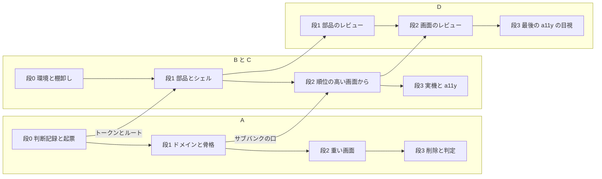

# 工程 — 画面刷新

[delivery-team-plan.md](delivery-team-plan.md) の体制で、キャンバスの画面を差し替える工程。各段の暦の日付は GitHub のマイルストーン（`刷新 0`〜`刷新 3`）が持つ。差し替えが済んだら、この文書は消す。

- **主指標:** P0 の 10 画面のうち、次の3つを満たすもの。0 / 10 → 10 / 10
  - 新しいルートで実データが流れる
  - 状態ごとの story があり、axe が緑
  - PR にボードと並べた写真が付いている
- **レーン:** A（Owner と重い機能）、B と C（Issue プール）、D（レビュー）

キーボードショートカットは今回は作らない。⌘ や ⇧ から起動するとボードに描かれている機能は、画面上の操作からだけ使えるようにし、ショートカットのチップも出さない。Tab と Enter / Space で操作できること（`TR-PLT-26`）は満たす。

## 画面の順位

切る線はこの順で下から引く。

| 順位 | ボード |
|---|---|
| 1 | [S04-Record](images/S04-Record.png) 収録 |
| 2 | [S06-Voice](images/S06-Voice.png) 音源のページ |
| 3 | [S02-Method](images/S02-Method.png) 音源の設定 |
| 4 | [S07-Songs](images/S07-Songs.png) 曲バンク |
| 5 | [S08-Review](images/S08-Review.png) 原音設定 |
| 6 | [S10-Handoff](images/S10-Handoff.png) 配布（配布物が1つ） |
| 7 | [S04-Listening](images/S04-Listening.png) 聴いている状態 |
| 8 | [S14-Settings](images/S14-Settings.png) 設定 |
| 9 | [S06b-Subbank](images/S06b-Subbank.png) サブバンクのページ（音高グラフは含めない） |
| 10 | [S11-Released](images/S11-Released.png) 手渡せる状態（存在声域の演出は含めない） |

P1 は S04-Unlocked、S06b-RenriOverlay（音高グラフ）、S10-Shelf、S10-Versions。段3の判定で持ち越しを決める。

## 段

| 段 | 名前 | 期間 | 関門 | 判定 |
|---|---|---|---|---|
| 0 | 設計・起票 | 1日 | 起票完了 | 全 Issue に受入条件がある。表層と運びの例外の判断記録がマージされている。B と C が環境の用意に着手している |
| 1 | 土台 | 3日 | 土台判定 | 新しいシェルで P0 の 10 画面のルートが開く（中身は仮でよい）。P0 の部品の story がすべて axe 緑。サブバンクの migration が `cargo xtask test-receipt` で緑で、既存のプロジェクトが開ける。実績から切る線を引き直した |
| 2 | 画面 | 4日 | 画面完了 | 引き直した線より上の画面がすべて主指標を満たす。旧画面の機能の棚卸しと突き合わせて、欠けが 0 件 |
| 3 | 差し替え・検証 | 1日 | Go / No-Go | P0 が 10 / 10。旧ルートを削除済み。実音声で「収録 → 試唱 → 書き出し」を一周し、960px の窓でも確認した。**未達なら、未達の画面は旧ルートを残したまま翌週へ持ち越す。** P1 の扱いもここで決める |

## 矢羽（レーン × 段）

| レーン / 段 | 0 | 1 | 2 | 3 |
|---|---|---|---|---|
| A | 判断記録（表層、サブバンク、運びの例外）と SDL、起票の確認 | サブバンクの migration と口、ルートの骨格 | 枠ごとの方式、収録の組み立て、ピアノロールの範囲の操作 | 旧ルートの削除と判定 |
| B / C | 環境の用意と、旧画面の機能の棚卸し | P6 の部品とシェル | 順位の高い画面から | 実音声での一周と a11y の記録 |
| D | — | 部品の PR のレビュー | 画面の PR のレビュー | 最後の a11y の目視 |

## 容量

供給は約 246h（A 約 100h、B と C が約 63h ずつ、D 約 20h）。P0 の需要は約 332h で、約 3 割足りない。

- **足りないのはプール。** 約 212h に対して B と C で 126h。届くのは土台と順位 1〜3 の画面までの見込みで、順位 4 より下は段1の関門で実績を見て切る線を決める
- A は約 120h。Issue の分に、Rust と meta のレビューと、D が間に合わないときの代わりのレビューを足した
- D の 20h で、フロントの PR 約 30 本を見る。着いてから2営業日以内を目安にし、間に合わないときは A が代わる
- P1 と P2（A 約 72h、プール約 44h）は供給に入れていない

## 次

- 段0の関門を通す。Issue の一覧と取り方の規則は、GitHub の追跡 Issue が持つ
